# DE-food-impact-analytics
A data engineering project comparing the environmental footprint and health profile of plant-based foods vs. conventional/animal-based foods, built on Microsoft Fabric using PySpark, OneLake, and Direct Lake Power BI.

# Plant-Based vs. Conventional Food Environmental & Health Impact Analytics

I wanted a project that used real public data instead of generated/mock data, and that forced me to deal with actually messy source data instead of something pre-cleaned. Food turned out to be a good fit for that — there's a well-known environmental impact study (Poore & Nemecek) and a huge, genuinely messy open product database (Open Food Facts), and combining the two lets you compare plant-based vs. conventional foods on both environmental and health grounds at once.

The goal is a working pipeline end to end — raw ingestion, cleaning, transformation, reporting — on Microsoft Fabric, built the way a real team would build it rather than a tutorial version.

## Architecture

Standard medallion setup on one Fabric Lakehouse:
- **Bronze** — raw data landed via OneLake Shortcuts, untouched
- **Silver** — cleaned Open Food Facts data, plus a mapping table linking it to the Poore & Nemecek food categories
- **Gold** — the actual comparison tables, feeding a Power BI report over Direct Lake

## Data

| Source | What it gives me |
|---|---|
| Open Food Facts | Nutri-Score (an A to E nutrition grade), NOVA group (a 1 to 4 score for how processed a food is), nutrients, category tags — messy, raw, needs real cleaning |
| Poore & Nemecek (2018), via Our World in Data (OWID) | Greenhouse gas (GHG) emissions, land use, freshwater withdrawal per kg, across 38 food categories — curated research data, treated as reference data rather than something to "clean" |

---

## Phase 1: Fabric Environment Setup

Set up the Fabric side before touching any data:
- Fabric workspace: `Plant_Vs_Conventional_Food_Analytics_Dev` (Trial Capacity, Central US)
- Lakehouse: `lh_plant_vs_conventional_dev`

Nothing to report on the challenges front for this one — it was just clicking through the Fabric UI.

---

## Phase 2: Raw Data Staging & Bronze Ingestion via OneLake Shortcuts

This phase ended up being most of the actual work early on, and most of the real problems.

Set up an Azure Data Lake Storage Gen2 (ADLS Gen2) storage account (`stfoodimpactdev`, Central US, Standard, locally redundant storage, hierarchical namespace on) to stage both datasets before bringing them into Fabric.

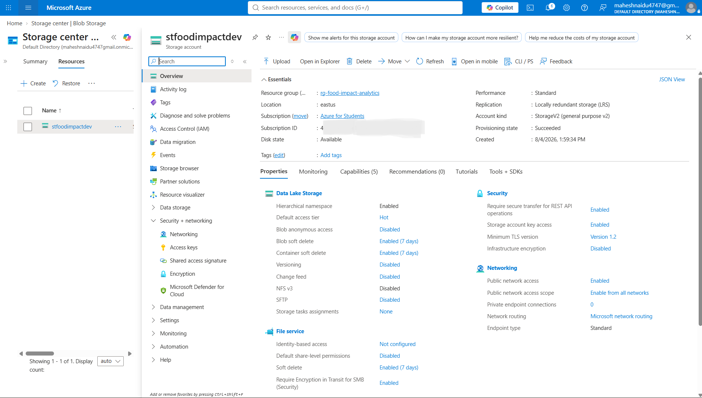

Two containers, named for what's actually in them rather than where they came from — `food-nutrition-health-data` and `food-environmental-impact` — since I figured six months from now I won't remember what "owid" stands for.

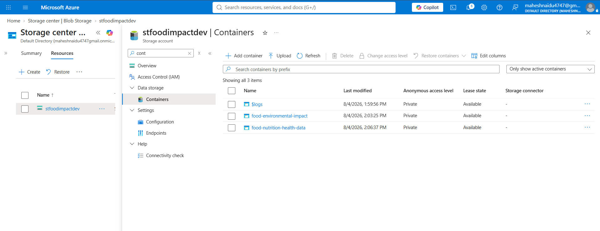

Grabbed the three Poore & Nemecek CSVs straight from Our World in Data's grapher URLs. Open Food Facts was the bigger job — pulled the Parquet export (~7.2GB) from Hugging Face through Azure Cloud Shell instead of downloading to my laptop first, so the transfer happened inside Azure's network rather than over my home connection twice. Before uploading it anywhere, read it back with pandas to make sure it wasn't truncated — came back with 4,655,195 rows, so the file was intact.

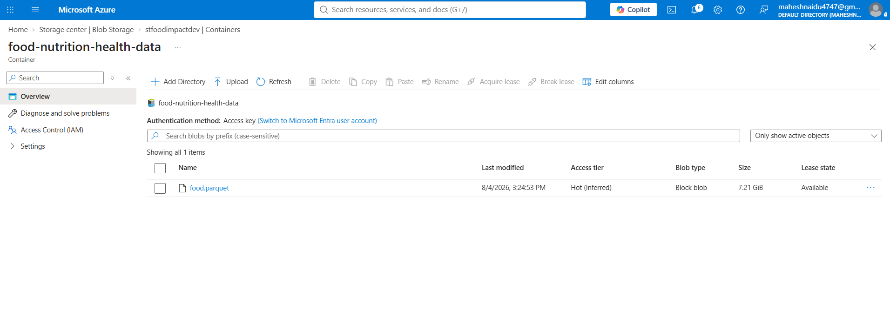

Along the way I hit a subscription issue unrelated to this project's actual data work — an old resource group from a different project had left networking infrastructure running in the background for months, billing hourly regardless of use. Tracked it down through Cost Analysis, deleted it, and set a $5 budget alert so it can't happen silently again. Also hit a role-based access control (RBAC) gap where `az storage blob upload --auth-mode login` just hung — being subscription Owner isn't the same as having the `Storage Blob Data Contributor` data-plane role. Worked around it with an account-key-based shared access signature (SAS) token instead, generated from the portal.

One more that cost some time: pasted a SAS token into a bash variable without quotes. SAS tokens are full of `&` characters, and bash reads unquoted `&` as "run this in the background" — so it silently split the token into several background jobs and only kept the first fragment. Got a `403 AuthorizationPermissionMismatch` and assumed it was a permissions problem again, when it was actually just a quoting bug. Lesson: always wrap tokens in single quotes.

Then created two OneLake Shortcuts (ADLS Gen2, SAS token auth) from the Lakehouse into those two containers. Skipped the "Transform to Delta" option Fabric offers during shortcut setup — didn't want any transformation logic sneaking into Bronze before I've even written the Silver notebook.

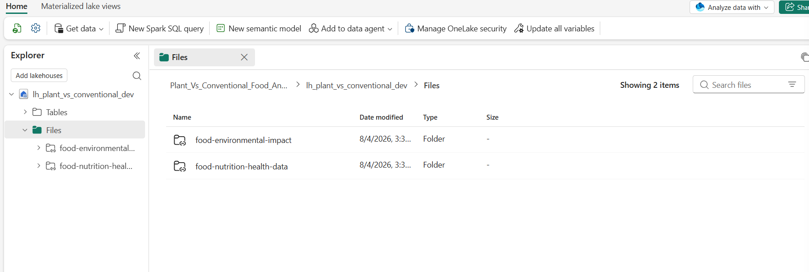

**Technical detail:**
- Storage account: `stfoodimpactdev`
- Containers: `food-nutrition-health-data`, `food-environmental-impact`
- Shortcuts: same names, under Lakehouse `Files/`
- Files: `food.parquet` (~7.2GB), plus six small CSVs from Our World in Data: GHG emissions, land use and freshwater withdrawals, each per kg and per 100g of protein

**Verifying the shortcuts actually work, not just exist:**

Configuring a shortcut in the Fabric UI doesn't guarantee it's actually readable — so I ran a quick read against each one from a notebook to confirm.

First, the Open Food Facts shortcut — read the Parquet file and print its schema:

```python
df = spark.read.parquet("Files/food-nutrition-health-data/food.parquet")
df.printSchema()
```

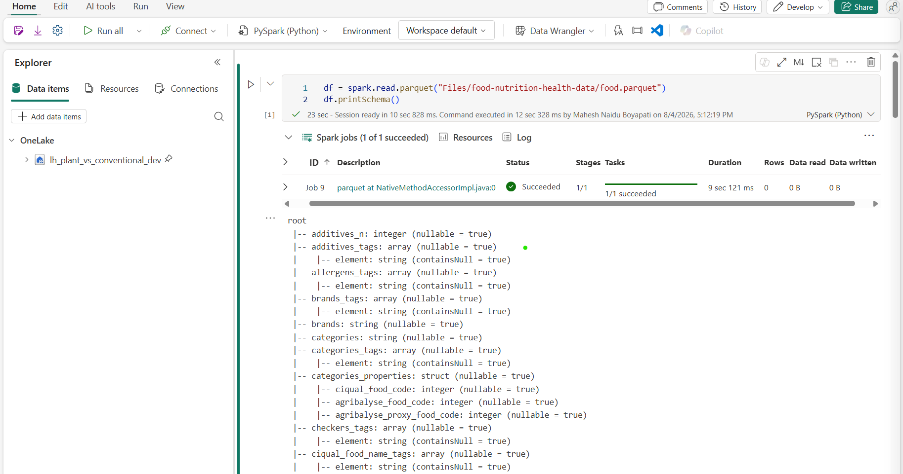

Then the Our World in Data (OWID) shortcut — read one of the CSVs and show a few rows:

```python
df = spark.read.csv("Files/food-environmental-impact/ghg-per-kg-poore.csv", header=True)
df.show(5)
```

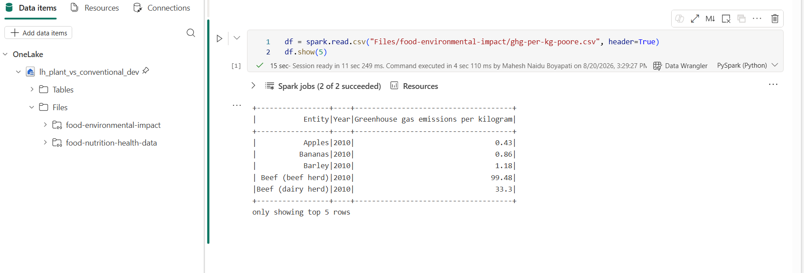

The SAS token ended up expiring twice. The first one was only valid for a few hours, so the OWID shortcut threw a `403 AccessDenied` when I got around to checking it. The replacement lasted a few weeks and then lapsed too, which broke both shortcuts the next time I opened a notebook. Both times the fix was the same: generate a new token and paste it into each shortcut's connection under Manage connections and gateways. This time I set the expiry much further out.

---

## Phase 3: Silver Transformation

This phase turned out to be less about cleaning code and more about finding out how little of Open Food Facts lines up with the environmental data, and deciding what to do about it.

### What the raw data looked like

A few things I didn't expect once I looked at the schema:

- Product names aren't a text column. Each one is an array of language/text pairs, so I have to pick one.
- The nutrients (fat, fiber, sugar and so on) aren't columns either. They sit in one array of name/value records per product.
- The category tags, which I planned to link on, are blank or a placeholder like `en:undefined` for 2,818,542 of the 4,655,195 products (60.5%). That leaves 1,836,653 products with a usable category.

Before dropping that 60.5% I wanted to know whether I'd be skewing the data, so I compared the countries of the tagged and untagged groups. France and the US lead both: about 28% and 20% of the tagged group, and 22% and 19% of the untagged one. Spain is a bit more common among the untagged (8% vs. 6%). Nothing alarming, so I went ahead with the tagged subset. Country is a weak check though, so I'm treating this as a limitation of the project, not something I've ruled out.

### Linking products to food categories

The environmental dataset has 38 entries like Beef, Cheese, Peas and Tofu, which are raw commodities. Open Food Facts is mostly snacks, ready meals and sodas, and those don't map to any of them. So the linking step, not the cleaning, is what limits how much data I can use.

I built three small reference tables by hand, working from the most common category tags in the data:

- `silver_food_category` has 37 food categories, each with a food group, an animal-or-plant flag, and a flag for whether it can be compared between plant and animal foods. The two beef entries in the environmental data (beef herd and dairy herd) are combined into one `Beef` category, because a product tag can't say which herd the meat came from. Gold keeps both figures and shows beef as a range.
- `silver_category_mapping` has 40 Open Food Facts tags mapped to those categories. Each row has a specificity (1 means the tag names the food itself, 2 a broader group tag, 3 a catch-all like "Other Fruit") and a match quality (direct or approximate).
- `silver_plant_alternatives` has 20 hand-picked animal-to-plant pairs (beef to tofu, peas or other pulses; milk to soy milk) for the "what could I swap this for" part of the report.

A few judgment calls worth writing down:
- Coffee, wine, dark chocolate and the two sugars are mapped but marked not comparable, since there's no animal-based version to compare them with.
- The environmental data only covers farmed fish and prawns, and the tags don't say farmed or wild, so fish and prawns are labelled approximate.
- Only soy drinks map to Soy milk. Oat, almond and rice drinks stay unmapped instead of borrowing soy's footprint.
- Six categories (Root Vegetables, Barley, Maize, Cassava, Cane Sugar and Beet Sugar) ended up with no products, because I found no usable tags for them.

After building the tables I ran a few checks: every category name in the environmental file exists in my category table, every mapping row points to a real category, and every alternative pair uses real categories on both sides. All came back 0.

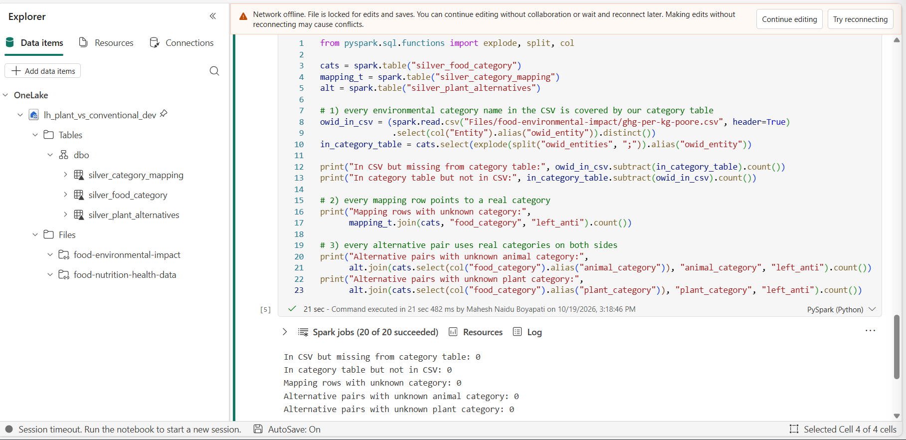

Then I assigned products. Each barcode keeps its newest non-obsolete row, language prefixes get fixed (some tags show up as `xx:tofu` instead of `en:tofu`), and when a product matches several tags the most specific one wins. That gave 376,581 products (about 8% of the whole dataset) exactly one category. Another 2,876 matched two categories equally well, so they went to `quarantine_ambiguous_category` instead of getting a guess. Most of those (2,225) were legume-versus-vegetable ties, like green beans, and 165 were fruit-versus-vegetable ties.

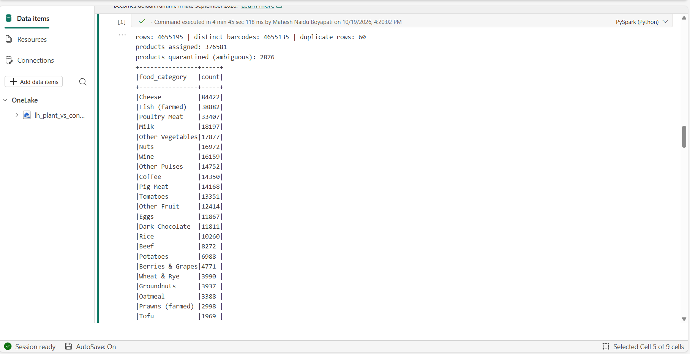

### The product table

`silver_food_products` has one row per assigned product: a clean name, Nutri-Score and NOVA (placeholder values turned into nulls), a vegan status from Open Food Facts' ingredient analysis, and eight nutrients per 100g. There were only 60 duplicate barcodes in 4.66 million rows, and the newest-row rule handles them.

How much of each field is actually filled in:

| Field | Products | Share |
|---|---|---|
| Product name | 366,722 | 97.4% |
| Nutri-Score | 276,238 | 73.4% |
| NOVA group | 161,254 | 42.8% |
| Energy | 304,677 | 80.9% |
| Protein | 304,718 | 80.9% |
| Fat | 304,495 | 80.9% |
| Saturated fat | 296,997 | 78.9% |
| Carbohydrates | 303,180 | 80.5% |
| Sugars | 295,641 | 78.5% |
| Fiber | 171,267 | 45.5% |
| Salt | 290,033 | 77.0% |

These numbers are from before the vegan cross-check below removed 8,341 products, so the table has 376,581 rows here and 368,240 at the end.

NOVA and fiber are the thin ones, so the report will need to show how many products each average is based on.


A few hundred values were impossible (negative, or more than 100g of something per 100g of food) and were set to null instead of dropped: 317 for energy, 201 for salt, and under 65 each for the rest. Another 583 products have numbers that contradict each other (saturated fat higher than total fat, or sugars higher than carbohydrates). Those are kept but flagged, and I leave them out of the averages.

### Cross-checking with the vegan analysis

I'd hoped the vegan status would be my plant-based flag, but 62% of the products have it as unknown, and only 36% have a firm vegan or non-vegan answer. So the plant/animal split comes from the food category, which is always filled in, and the vegan status became a cross-check instead.

The cross-check found 8,341 conflicts (about 2.2%). Some were vegan products filed under animal categories, like plant-based cheeses and meat substitutes that still carry a "cheeses" or "meats" tag. Most were non-vegan products filed under plant categories: cheesy potato bakes, chips with cheddar and sour cream, honey-roasted peanuts, caramel cappuccino mix. The biggest single group came through the broad `en:potatoes-and-their-products` tag, which lets processed foods in. I moved all of them into `quarantine_vegan_conflict` and removed them from the Silver table, which leaves 368,240 products.

Where the ingredient analysis gave a firm answer, it agreed with my category label for 99% of products in animal categories (82,589 of 83,229) and for 85% of products in plant categories (45,235 of 52,936).


```sql
-- products per food category in the Silver table
SELECT food_category, COUNT(*) AS products
FROM silver_food_products
GROUP BY food_category
ORDER BY products DESC;
```

**Tables from this phase:** `silver_food_category`, `silver_category_mapping`, `silver_plant_alternatives`, `silver_product_category`, `silver_food_products`, `quarantine_ambiguous_category`, `quarantine_vegan_conflict`.

---

## Phase 4: Gold Aggregation

I built Gold around the report I want at the end: someone picks a food and sees what it is, what's in it, what it costs the environment, how healthy it is, and what plant-based food could replace it. That gave me three Gold tables, plus one reference table that feeds them.

### What I built

- `silver_env_impact` has the environmental data from all six CSV files (greenhouse gases, land use and water, each per kg and per 100g of protein), joined into one row per food.
- `gold_category_profile` has one row per food category (37). Each row has the average of eight nutrients per 100g, and how many products each average is based on. It also has Nutri-Score as an average score (A is 1, E is 5) plus the share rated A or B, and NOVA as an average plus the share that are ultra-processed (group 4). The environmental numbers sit next to them, each with a low, mid and high value. Only beef has a real range: 33.3 to 99.5 kg of CO2-equivalent (CO2e) per kg, from the dairy herd and beef herd figures. The products I flagged as having contradictory nutrient numbers are left out of the averages.
- `gold_plant_swaps` has the 20 animal-to-plant pairs from Silver, with the change in emissions, land and water, and the difference in each nutrient.
- `gold_product_examples` has up to 10 real products per category (310 in total), so the report can show what a category actually contains.

### Approximate matches were skewing the averages

Some of my tag mappings are approximate: a broad tag like `en:potatoes-and-their-products` lets in processed food. I compared each category's averages with and without them. Potatoes changed the most: saturated fat dropped from 2.6g to 0.5g per 100g, and the Nutri-Score average went from 3.17 to 1.97, because chips and cheesy potato dishes were dragging the numbers. Wheat & Rye moved too (saturated fat from 0.4g to 0.7g). Beef, Pig Meat and Oatmeal barely moved.

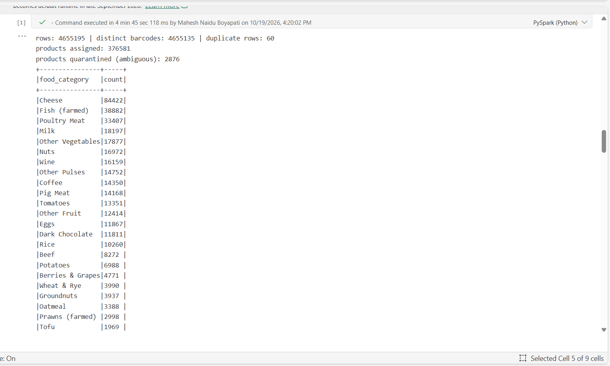

So the rule is: if a category has at least 500 direct matches, its averages use only those. That applies to 28 of the 37 categories. Fish, prawns and tomatoes have no direct matches at all, so they use everything and carry a flag saying so. The six empty categories are marked `none`. Each row records which basis it used (`basis_used`) and what share of its products were direct matches.

### Swaps

I compare each pair per 100g of protein, since comparing beef and tofu per kg isn't fair. Milk to soy milk is the exception, because soy milk has no per-protein figure, so it's compared per kg. Every row says which basis it used.

Some results:
- Beef to tofu cuts emissions by 94%, land by 98% and water by 91%. Peas and other pulses are similar.
- Cheese to nuts cuts emissions by 98% but water use not at all, since nuts need a lot of water. Cheese to tofu cuts water by 96%.
- Some swaps are worse on land: eggs to other pulses by 29%, prawns to tofu by 9% and prawns to peas by 67%. Farmed prawns use very little land per gram of protein.
- Eggs to tofu is slightly worse on Nutri-Score (+0.32 points).


The nutrition differences are per 100g of food as sold, not per equal protein, and that matters. The meat and fish swaps leave you with 3 to 15g less protein per 100g (beef to peas is the biggest gap). Milk to soy milk loses under 1g, cheese to nuts about 2g and cheese to tofu about 6.5g. Eggs are the closest: tofu has 1.2g more per 100g, other pulses 1.1g less. That mix is an approximation, so the report needs to show the protein difference next to the savings.

```sql
-- biggest emissions savings for the top-ranked swap of each animal food
SELECT animal_category, plant_category, ghg_reduction_pct, land_reduction_pct, water_reduction_pct
FROM gold_plant_swaps
WHERE rank = 1
ORDER BY ghg_reduction_pct DESC;
```

### Things that went wrong or need saying

- While reviewing the notebook I found the swaps cell sat above the profile rebuild it depends on. A clean run would have built the swaps from the old numbers. I reordered the cells and ran the whole notebook top to bottom once, and the numbers matched.
- My first version of the examples sorted names alphabetically as the last tie-break, so the beef list was full of duplicates like "1 Entrecôte" and "1 / 3 Boeuf Gelee". I switched to one row per name, skipped names starting with a digit, and picked among equally complete products in a fixed pseudo-random order. A few names are still in French or Polish, because the name falls back to the product's main language when there's no English one.
- Every product in a category gets the same environmental number, since the study only has category-level data. And Open Food Facts is crowdsourced, so the products reflect what people chose to add, not what people eat.

**Tables from this phase:** `silver_env_impact`, `gold_category_profile`, `gold_plant_swaps`, `gold_product_examples`.

All eleven tables in the Lakehouse after this phase:

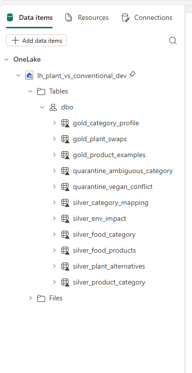

---

## Phase 5: Power BI Reporting

I built the report on a Direct Lake semantic model, so it reads the Gold tables straight from the Lakehouse, with no import and no refresh schedule. A PDF of the finished report is in [report/rpt_food_impact.pdf](report/rpt_food_impact.pdf).

### The semantic model

`sm_food_impact` has three tables (`gold_category_profile`, `gold_plant_swaps` and `gold_product_examples`) and two relationships. The profile table connects to the swaps table (`food_category` to `animal_category`) and to the examples table (`food_category`), both one-to-many with a single filter direction. Direct Lake doesn't validate relationships, so I set the cardinality by hand.

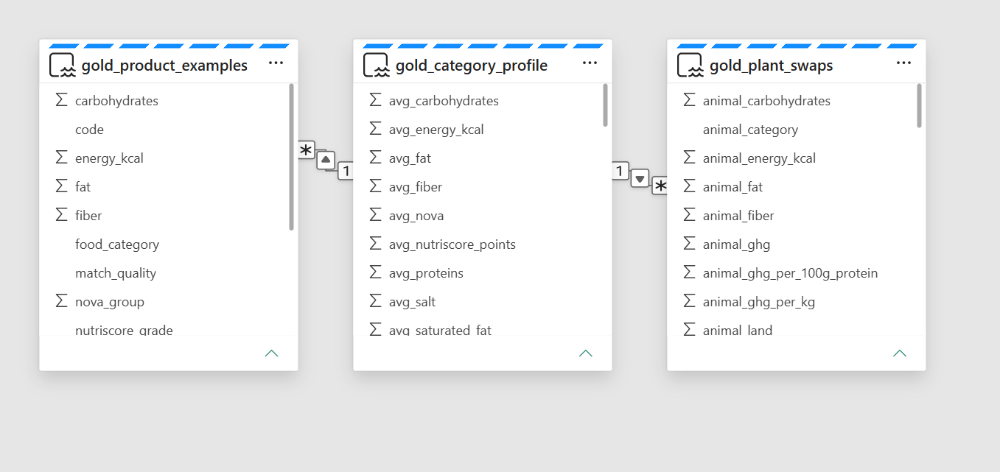

I also wrote a few measures in DAX, Power BI's formula language. Three of them show the environmental numbers as a range, which is how beef shows 33.3 to 99.5 instead of a misleading midpoint:

```
GHG per kg range = 
VAR lo = MIN(gold_category_profile[ghg_per_kg_low])
VAR hi = MAX(gold_category_profile[ghg_per_kg_high])
RETURN IF(ISBLANK(lo), BLANK(), IF(lo = hi, FORMAT(lo, "0.0"), FORMAT(lo, "0.0") & " to " & FORMAT(hi, "0.0")))
```

The land use and water measures follow the same pattern. The others return "Animal-based" or "Plant-based", the food group, and the product count as formatted text. The text ones exist because the web editor showed text columns sideways in cards and turned 6,961 into "7K".

### The report

It has three pages, built in the Fabric web editor.

**Food explorer.** Pick a food and see what it is (animal or plant, and its food group), its environmental footprint per kg, its average nutrition per 100g, its Nutri-Score and NOVA scores with the number of products behind them, and up to 10 example products.

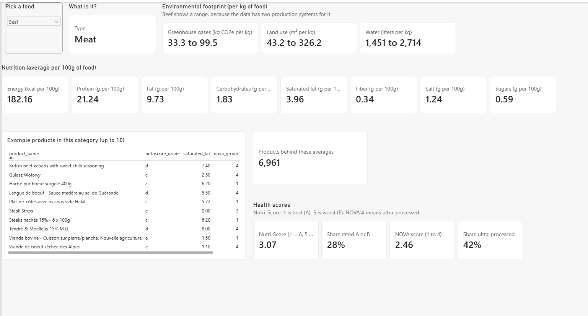

**Plant-based swaps.** Pick one of the nine animal foods and see each plant alternative: how much lower the emissions, land use and water are (negative means worse), and a table of what you gain or lose in protein, fiber, saturated fat and Nutri-Score.

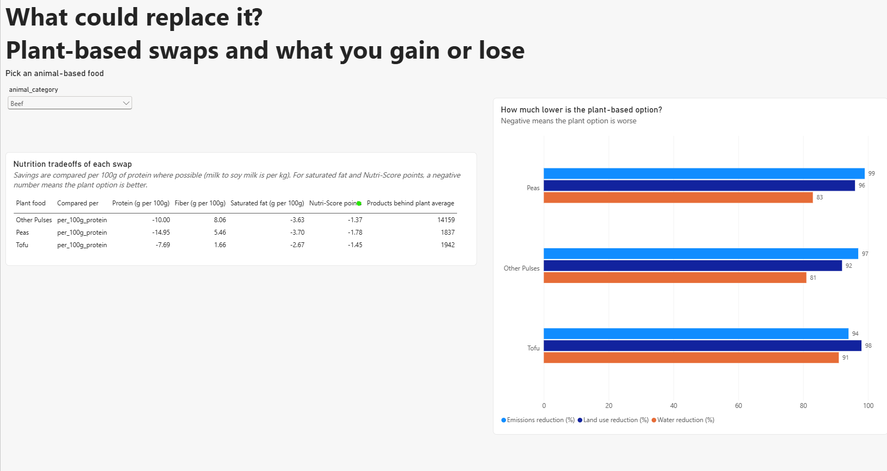

**Compare everything.** Greenhouse gas emissions on a log scale against Nutri-Score points for 28 foods, with bubble size showing how many products sit behind each average. Orange is animal-based and green is plant-based. Coffee, wine, dark chocolate, the sugars and the empty categories are left out.

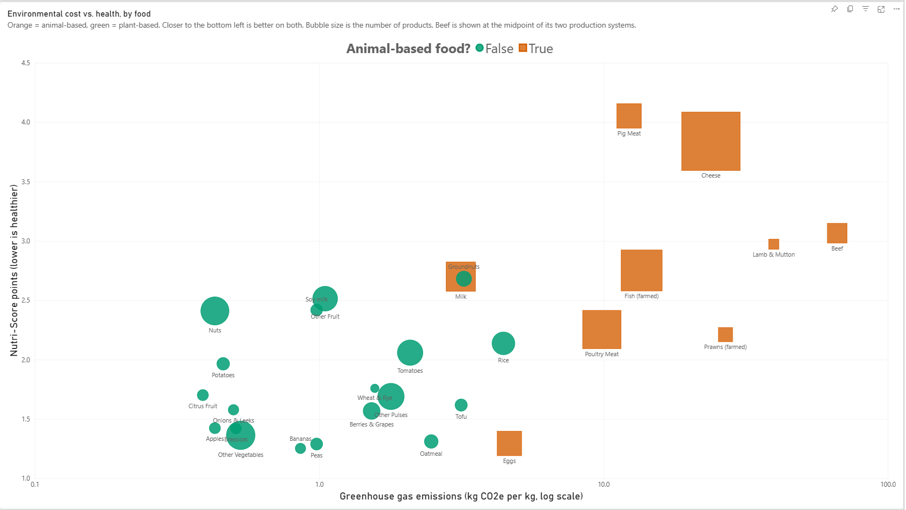

### What it shows

- Beef runs from 33.3 to 99.5 kg CO2e per kg, against 3.2 for tofu.
- Cheese and pig meat are the worst on both counts. Cheese has about 16g of saturated fat per 100g and a Nutri-Score average of 3.84, and pig meat is at 4.08.
- Eggs are the exception among animal foods, with a Nutri-Score average of 1.29.
- Replacing beef with tofu, peas or other pulses cuts emissions by 94 to 99% per 100g of protein. Not every swap wins, though: cheese to nuts saves no water, and eggs to other pulses uses 29% more land.

### Things that didn't go smoothly

- The web editor has fewer settings than Power BI Desktop. There's no Column tools tab, so I set percentage formats on the model, and the display units setting wasn't where the docs said, so I used text measures instead.
- Direct Lake models don't support calculated columns, and I didn't want to rebuild the Gold table at the end. So the legend on the comparison chart reads True and False for "animal-based food?", and the title and subtitle explain what that means.
- The environmental figure is per category, so every product in a category shows the same footprint.
- The live report runs on a Fabric trial capacity that ends at the start of November 2026, and the report goes with it. That's why this repo has the PDF, screenshots and CSV exports.

### Rebuilding it

The notebooks in `notebooks/` rebuild every table from the raw Open Food Facts file (about 7GB, [downloaded from Hugging Face](https://huggingface.co/datasets/openfoodfacts/product-database)) and the six Our World in Data CSVs. The product-level Silver tables are too big to commit. To rebuild just the report, load the three Gold CSVs from `data/` into Power BI Desktop (free), recreate the two relationships and add the measures above.

### What's in the repo

```
notebooks/     the exploration, Silver and Gold notebooks
data/          CSV exports of the reference tables and the Gold tables
report/        the report as a PDF
screenshots/   the images used in this README
```

**Items from this phase:** `sm_food_impact`, `rpt_food_impact`.

---

## Stack
Microsoft Fabric (Lakehouse, OneLake, Data Pipelines), PySpark, Delta Lake, Power BI (Direct Lake semantic model and report), Azure Data Lake Storage Gen2, Azure Cloud Shell / AzCopy.

## Status
- [x] Phase 1: Fabric Environment Setup
- [x] Phase 2: Raw Data Staging & Bronze Ingestion via OneLake Shortcuts
- [x] Phase 3: Silver Transformation
- [x] Phase 4: Gold Aggregation
- [x] Phase 5: Power BI Reporting

## Data credit
- Open Food Facts data © Open Food Facts contributors, ODbL license.
- Environmental data: Poore, J., & Nemecek, T. (2018). *Reducing food's environmental impacts through producers and consumers.* Science, 360(6392), 987–992. Via Our World in Data, CC BY.

## Author
Mahesh Boyapati
